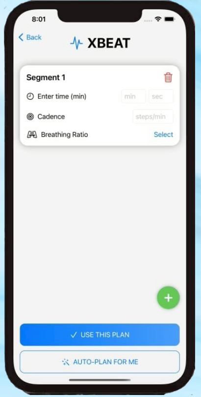
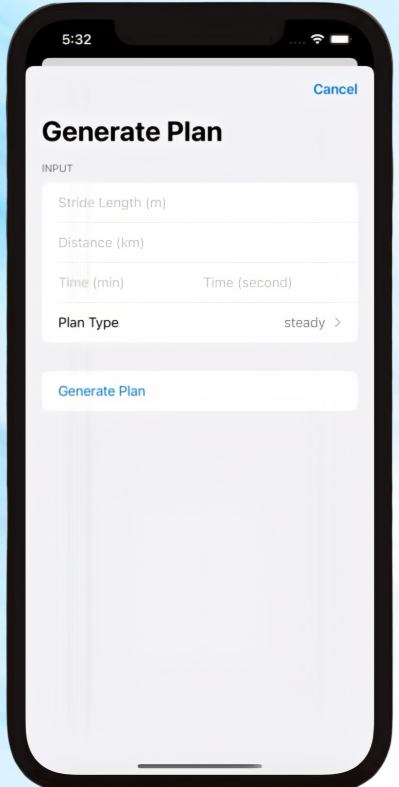
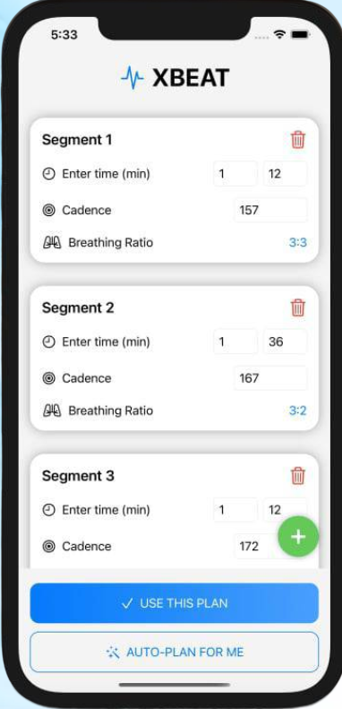
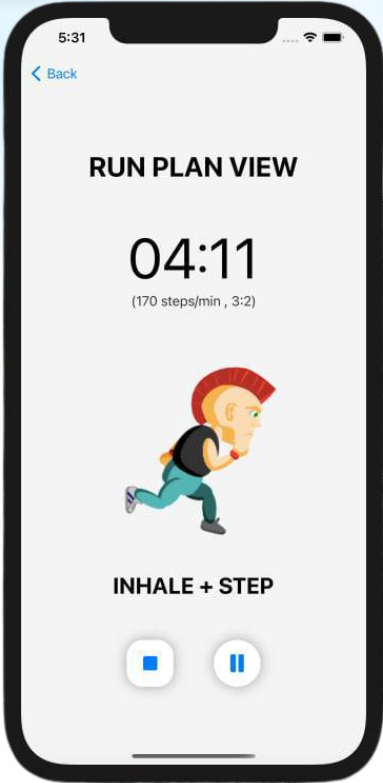

# XBEAT

Design your running cadence and breathing rhythm, then follow each step and breath with a metronome.

**iOS prototype · Swift · SwiftUI · Solo developer**

## Overview

Keeping a consistent step rhythm and coordinating breathing can be difficult during a run. XBEAT turns a running goal into editable segments, each with its own duration, cadence, and breathing ratio.

Build a plan manually or generate one from distance, target time, and step length. During the run, audio and visual cues guide you through the plan.

**Status:** Prototype. The repository contains Swift source and resources; Xcode project setup is currently manual.

## Key Features

- **Manual plan editor:** Add, edit, and delete numbered segments.
- **Automatic planning:** Generate steady, progressive, or interval plans.
- **Editable results:** Adjust generated segments before selecting **Use this plan**.
- **Breathing patterns:** Choose ratios such as `3:3`, `3:2`, `2:2`, and `2:1`.
- **Metronome guidance:** Distinct sounds mark inhalation, exhalation, and intermediate steps.
- **Run controls:** View the segment countdown, cadence, and breathing cue; pause, resume, or stop.

## How It Works

**Inputs → Generated segments → Review and edit → Metronome guidance**

1. Enter stride length (m), distance (km), target time (min/sec), and plan type.
2. XBEAT estimates a baseline cadence and creates timed segments.
3. Review and edit the plan, or choose **Auto-plan for me** to generate another.
4. Start the run and follow **INHALE + STEP**, **EXHALE + STEP**, and **STEP** cues.

The generator uses:

    Total steps = distance in meters / entered length
    Baseline cadence = round(total steps / target time in minutes)
    Beat interval = 60 / segment cadence

The calculation treats the field labeled “Stride Length” as **meters per step**. A `3:2` breathing ratio means inhaling over three steps and exhaling over two. High and mid tones mark the start of inhalation and exhalation; low tones mark intermediate steps.

## Plan Types

| Type | Cadence pattern | Segment timing |
| --- | --- | --- |
| **Steady** | Baseline cadence throughout | One segment for the full duration |
| **Progressive** | Baseline −10, baseline, then baseline +5 steps/min | 30%, 40%, then 30% of the duration |
| **Interval** | Alternate baseline +10 and −10 steps/min | Three-minute fast/easy segments; remaining time uses baseline cadence |

Steady and interval plans select breathing ratios using pace-based rules. Progressive plans use `3:3`, `3:2`, and `2:2` across their three segments.

These are prototype planning rules. Target distance and time inform the calculation; the app does not verify that the runner achieves them.

## Screenshots

Simulator views of the prototype, from planning to run guidance.

| Manual plan | Generate Plan | Review plan | Run Plan View |
| :---: | :---: | :---: | :---: |
|  |  |  |  |
| Build segments with your own rhythm. | Enter a goal and choose a plan type. | Adjust segments before running. | Follow live step and breathing cues. |

### Demo Video

https://github.com/user-attachments/assets/d31545ef-a923-4a5b-b2fe-b1cf5ad94c39
(have sound)

## Tech Stack

| Technology | Use |
| --- | --- |
| **Swift** | Plan calculations, models, and playback logic |
| **SwiftUI** | Segment editor, forms, and run interface |
| **AVFoundation / AVAudioPlayer** | Playback of three bundled metronome tones |
| **Foundation Timer** | Beat scheduling and segment countdown |

## Getting Started

**Requirements:** A Mac with Xcode. [TODO: Confirm the tested Xcode version and minimum iOS deployment target.]

1. Clone: `git clone https://github.com/Poonmeemana/XBEAT.git`
2. Create an iOS App project in Xcode using Swift and SwiftUI.
3. Add the Swift files from `App/`, `Views/`, `Components/`, `Models/`, and `Services/` to the app target.
4. Remove the generated app entry point so `XBEATApp` is the only `@main` type.
5. Add `high.wav`, `mid.wav`, and `low.wav` from `Resources/Audio/` to **Copy Bundle Resources** as individual files.
6. Supply image assets named `stepLeft` and `stepRight`; the required asset catalog is not yet included.
7. Select an iOS simulator or configure signing for an iPhone, then build and run.

When importing into an existing Xcode project, update file references to the new paths and confirm target membership. Check plan generation, segment transitions, audio, and pause/resume on a simulator or device.

## Project Structure

```text
XBEAT/
├── README.md
├── App/
│   └── XBEATApp.swift            # App entry point
├── Views/
│   ├── Onboarding/
│   │   ├── beginningView.swift   # Welcome screen
│   │   └── loginView.swift       # Profile input screen
│   ├── Planning/
│   │   ├── ContentView.swift     # Plan editor
│   │   └── PlanInputSheet.swift  # Automatic plan input
│   └── Running/
│       └── RunPlanView.swift     # Run timer and guidance
├── Components/
│   └── FloatingAddButton.swift  # Reusable add button
├── Models/
│   ├── PlanSegment.swift        # Segment data
│   └── PlanType.swift           # Available plan types
├── Services/
│   ├── PlanLogic.swift          # Plan generation
│   └── Metronome.swift          # Audio rhythm playback
├── Resources/
│   ├── Audio/                  # high.wav, mid.wav, low.wav
│   └── Images/                 # run0.png, run4.png
└── docs/
    ├── images/                 # manual-plan.png, generate-plan.png,
    │                           # review-plan.png, run-plan.png
    └── videos/xbeat.mp4         # Demo video
```

## Roadmap

Suggested next steps for the prototype:

- [ ] Add a ready-to-run Xcode project and complete the image asset catalog.
- [ ] Strengthen numeric input validation and clarify the step-length label.
- [ ] Test plan calculations, segment transitions, and pause/resume behavior.
- [ ] Evaluate audio timing, interruptions, and playback while the screen is locked.
- [ ] Explore Apple Watch support, as outlined in the project concept.

[TODO: Confirm roadmap priorities.]

## My Contribution & Learning

As the **solo developer**, I built the SwiftUI planning flow, automatic segment generation, and metronome-guided run experience.

The implementation connects editable segment data with cadence calculations, repeating audio patterns, and live visual cues.

[TODO: Add one specific engineering challenge, how you addressed it, and what you learned.]
[TODO: Add device-testing results or user feedback when available.]

## Contact & Links

- **Source:** [GitHub repository](https://github.com/Poonmeemana/XBEAT)
- **GitHub:** [@Poonmeemana](https://github.com/Poonmeemana)
- **Contact:** [TODO: Add your preferred email, LinkedIn, or portfolio link.]
